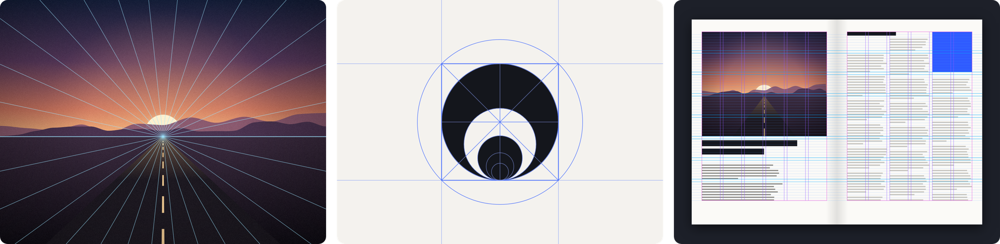
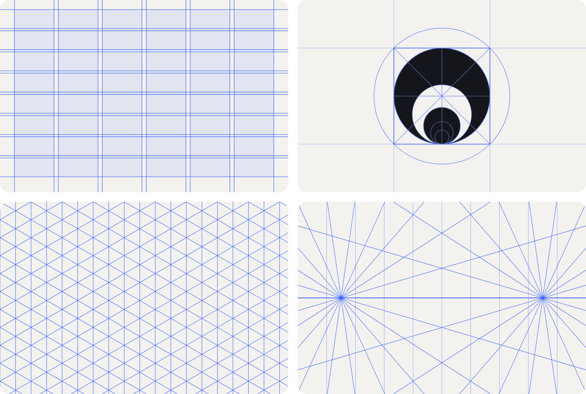
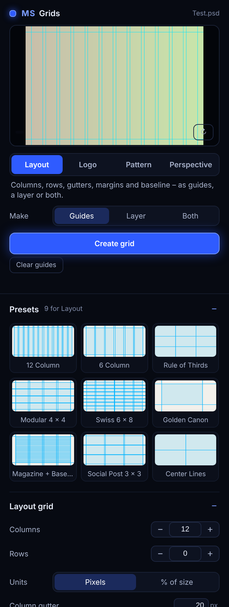
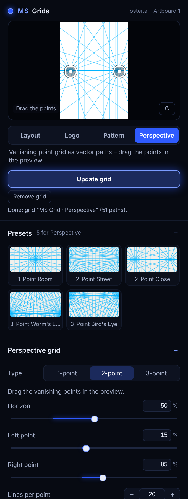

<p align="center">
  
</p>

<p align="center">
  <b>One grid tool for Photoshop, Illustrator and InDesign: layout grids, logo construction grids,
  pattern grids and perspective grids – with a live preview of your document.</b><br>
  <sub>Left to right: Photoshop · Illustrator · InDesign</sub><br>
  <sub>Free tools by <b>Morgenstern</b> · <a href="https://github.com/M0rgenst3rn/ms-distress">Morgenstern Distress</a> · <a href="https://github.com/M0rgenst3rn/ms-printer">Morgenstern Printer</a> · <a href="https://github.com/M0rgenst3rn/ms-render">Morgenstern Render</a> · <a href="https://github.com/M0rgenst3rn/ms-phase">Morgenstern Phase</a> · <a href="https://github.com/M0rgenst3rn/ms-glow">Morgenstern Glow</a> · <a href="https://github.com/M0rgenst3rn/ms-gradients">Morgenstern Gradients</a> · <b>Morgenstern Grids</b></sub>
</p>

---

## What is Morgenstern Grids?

A panel for every grid a designer needs, in the three apps where you need them. The panel looks and works
the same everywhere: pick a grid, pick a preset or set the values, check the preview, click **Create grid**.
What you get is native to each app – real guides, layers or paths, margins and columns.

|                                               | Photoshop                | Illustrator             | InDesign                                       |
| --------------------------------------------- | ------------------------ | ----------------------- | ---------------------------------------------- |
| **Layout** – columns, rows, margins, baseline | ✓                        | ✓                       | ✓                                              |
| **Logo** construction grids                   | ✓                        | ✓                       | –                                              |
| **Pattern** grids                             | ✓                        | ✓                       | –                                              |
| **Perspective** grids                         | ✓                        | ✓                       | –                                              |
| The grid becomes                              | guides and a pixel layer | guides and vector paths | margins & columns, ruler guides, baseline grid |
| Needs                                         | Photoshop 2023 (24.2)    | Illustrator 2020 (24)   | InDesign 2023 (18.5)                           |

## The grids

<p align="center"></p>

- **Layout**: columns, rows, gutters, margins and a baseline grid – in pixels, points, millimetres or % of
  the size, depending on the app. Presets in % fit any format
- **Logo**: construction lines around the selected logo – bounding box, centre lines, diagonals, circles,
  golden ratio circles, golden spiral and a square grid
- **Pattern**: square, dot, diamond, triangle, isometric and hexagon grids
- **Perspective**: 1-, 2- and 3-point grids. Drag the vanishing points right in the preview

In every app:

- **Presets** for every kind (12 / 6 column, Swiss, golden canon, magazine with baseline, isometric,
  2-point street …) and your **own presets**
- **Live preview** of your document with the grid on top, before anything changes
- **Editable later**: select a grid made by the panel, change the values, click **Update grid**
- **Fits the format**: grids are calculated for the current canvas, artboard or page. In Photoshop and
  Illustrator they are drawn again when it changes size
- **Self-test** that checks every function against the real app

### What is different per app

- **Photoshop**: guides are Photoshop guides; everything else is a pixel layer with smooth lines that keeps
  its settings. A grid fills the canvas or just the selected layer.
- **Illustrator**: guides are Illustrator guides; grids are groups of vector paths in your colour, line width
  and opacity, on their own layer. A grid fills the active artboard or the selection.
- **InDesign**: made for page layout. Columns become InDesign's own margins and columns, so text frames
  and Layout Adjustment use them. Rows snap to the baseline grid, so text in every module shares the same
  baselines. Applies to the parent page, a page, the spread or all pages, with facing pages mirrored.

## The panel

<table>
  <tr>
    <td align="center"><br><sub>Photoshop</sub></td>
    <td align="center"><br><sub>Illustrator</sub></td>
    <td align="center"><br><sub>InDesign</sub></td>
  </tr>
</table>

## How to use it

1. Open a document and the panel: Photoshop **Plugins › MS Grids** · Illustrator **Window › Extensions ›
   MS Grids** · InDesign **Plug-ins › MS Grids**
2. Pick the kind of grid (Photoshop and Illustrator) and a preset, or set the values
3. For a **logo** grid, select the logo first. In InDesign, choose what to **apply to** (parent page by default)
4. Click **Create grid** (InDesign: **Apply grid**)
5. **Change it later**: select the grid, adjust, click **Update grid**

**Tip:** guides can be hidden and shown with **Cmd/Ctrl + ;** in all three apps.

## Installation

### Download (easiest)

On the **[Releases](https://github.com/M0rgenst3rn/ms-grids/releases/latest)** page:

| App         | File                       | How                                                                               |
| ----------- | -------------------------- | --------------------------------------------------------------------------------- |
| Photoshop   | `MS-Grids-Photoshop.ccx`   | Double-click – the Creative Cloud app installs it                                 |
| InDesign    | `MS-Grids-InDesign.ccx`    | Double-click – the Creative Cloud app installs it                                 |
| Illustrator | `MS-Grids-Illustrator.zip` | Unzip, then run `install-illustrator-mac.sh` or `install-illustrator-windows.cmd` |

Then (re)start the app.

### macOS with Terminal

Download the repository (**Code → Download ZIP**), unzip it and run the installer for your app inside the folder:

```bash
bash install-mac.sh              # Photoshop
bash install-illustrator-mac.sh  # Illustrator
bash install-indesign-mac.sh     # InDesign
```

### About the Illustrator version

Illustrator doesn't let plugins from outside Adobe's marketplace use the newer panel technology that
Photoshop and InDesign use, so MS Grids for Illustrator is a CEP panel. Such panels must be signed – or
Illustrator is told to load unsigned panels. The installer does the latter (the "PlayerDebugMode" setting,
for the current user) and copies the panel to `~/Library/Application Support/Adobe/CEP/extensions`
(Windows: `%APPDATA%\Adobe\CEP\extensions`). To uninstall, delete the folder
`com.linus.msgrids.illustrator` there.

### Alternative for Photoshop and InDesign: UXP Developer Tool (macOS & Windows)

1. Install "UXP Developer Tools" from the Creative Cloud app
2. In Photoshop, turn on **Developer Mode** under *Settings › Plugins*
3. In the UXP Developer Tool choose **Add Plugin**, then `grids/manifest.json` (Photoshop) or
   `grids-id/manifest.json` (InDesign) → **Load**

### Self-test

In the panel, open the last section and click **Self-test**. It checks every function against the real app.
In Illustrator and InDesign it creates a test document – close it afterwards without saving.

## Project structure

```
grids/               Photoshop plugin (UXP): main.js, core.js (grid geometry and drawing), ms-ui.js/.css
grids-ai/            Illustrator panel (CEP): main.js, jsx/host.jsx (Illustrator side), CSXS/manifest.xml
                     – shares core.js and ms-ui.js/.css with grids/
grids-id/            InDesign plugin (UXP): main.js, core.js (page grid maths)
install-*            Installers per app
tools/               Checks, browser previews of the panels, README images
docs/images/         Images of this README
```

```bash
node tools/check.js              # Photoshop: geometry, presets, drawing
node tools/check-illustrator.js  # Illustrator: shared files, host script
node tools/check-indesign.js     # InDesign: page grid maths
```

`tools/readme-images.html` draws the README images with the real grid maths (open it through a local web server).

## Found a bug? Got an idea?

Get in touch! The easiest way is **[Issues](https://github.com/M0rgenst3rn/ms-grids/issues)** here on GitHub:
click **New issue** and briefly describe what happened. Which app and version, your operating system and a
screenshot help a lot. All you need is a free GitHub account. Suggestions and feature requests are just as
welcome.

## License

[MIT with the Commons Clause](LICENSE): the plugins are free. You may use them for any work, including paid
client work, and you may read, change and share the code.
You may not sell the plugins or a version of them (changed or not), or charge for a product or service whose
value comes mainly from them.
Everything you create with them (designs, images, layouts, prints) is yours, and you may sell it.
The license notice stays in copies.

Adobe, Photoshop, Illustrator and InDesign are trademarks of Adobe Inc. This project is independent and not
affiliated with Adobe.

---

<p align="center"><sub>Morgenstern Grids<br>
Made by Linus Leinberger</sub></p>
