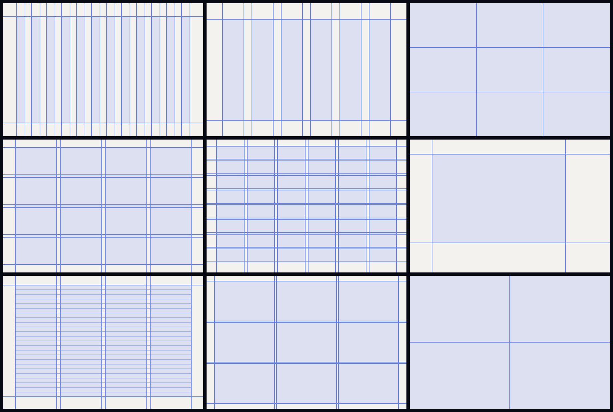
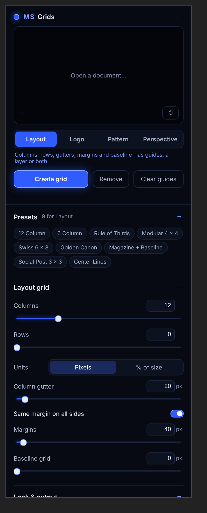
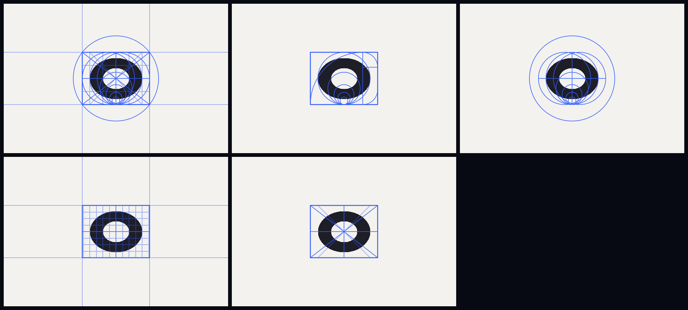
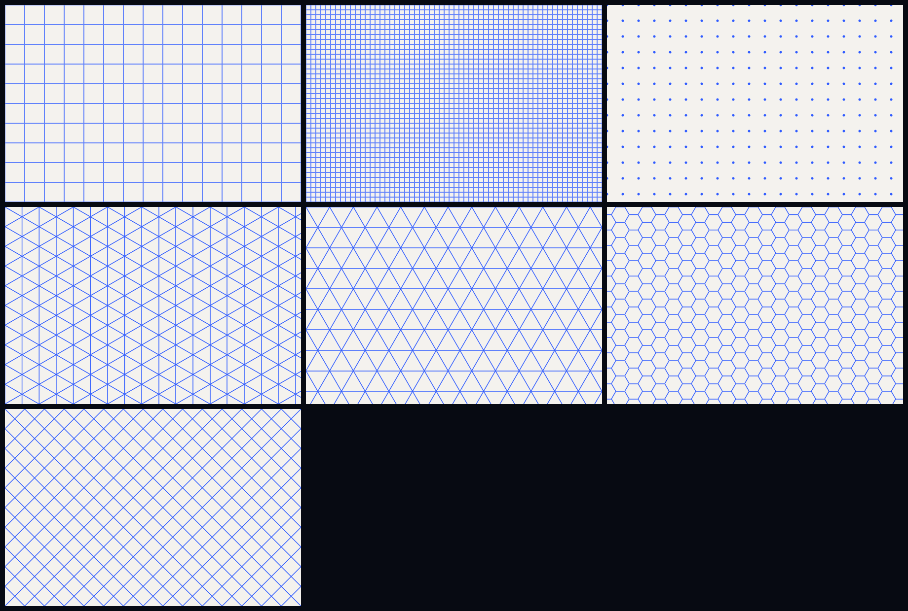
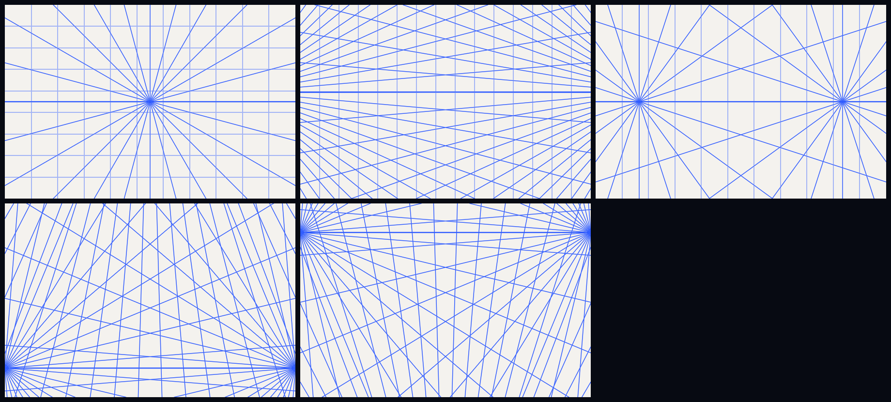

<p align="center">
  
</p>

<p align="center">
  <b>Grids for Photoshop: layout grids as real guides, logo construction grids, pattern grids and
  perspective grids – with a live preview of your document.</b><br>
  <sub>Photoshop 2023 (24.2) or newer · UXP panel</sub><br>
  <sub>Free Photoshop tools by <b>Morgenstern</b> · <a href="https://github.com/M0rgenst3rn/ms-distress">Morgenstern Distress</a> · <a href="https://github.com/M0rgenst3rn/ms-printer">Morgenstern Printer</a> · <a href="https://github.com/M0rgenst3rn/ms-render">Morgenstern Render</a> · <a href="https://github.com/M0rgenst3rn/ms-phase">Morgenstern Phase</a> · <a href="https://github.com/M0rgenst3rn/ms-glow">Morgenstern Glow</a> · <a href="https://github.com/M0rgenst3rn/ms-gradients">Morgenstern Gradients</a> · <b>Morgenstern Grids</b></sub>
</p>

---

## What is Morgenstern Grids?

One panel for every grid a designer needs in Photoshop:

- **Layout**: columns, rows, gutters, margins and a baseline grid, as Photoshop guides, as a layer, or both
- **Logo**: construction lines around a logo – bounding box, centre lines, diagonals, circles, golden ratio circles, golden spiral and a square grid
- **Pattern**: square, dot, diamond, triangle, isometric and hexagon grids
- **Perspective**: 1-, 2- and 3-point grids. Drag the vanishing points right in the preview

The preview shows your document with the grid on top, before anything changes. Guides are Photoshop's own
guides. Everything else becomes a normal pixel layer with smooth lines that keeps its settings: select it
later, change the values and click **Update grid**.

<p align="center"></p>

### Highlights

- **4 grid kinds, 26 presets**: 12 / 6 column, rule of thirds, modular, Swiss, golden canon, magazine with baseline, social post …
- **Pixels or %**: gutters and margins in pixels or in percent of the size, so a preset fits any format
- **Real guides**: layout grids become Photoshop guides, which snap like any other guide. "Replace existing guides" keeps it tidy
- **Canvas or layer**: fill the whole canvas or just the bounds of the selected layer
- **Logo grids** are built around the selected layer, e.g. your logo or lettering
- **Draggable vanishing points** in the preview for perspective grids
- **Colour, line width, opacity** and a light column tint for layout layers
- **Editable later**: grid layers remember their settings
- **Own presets** and a **self-test** against the real Photoshop result

## The grids

**Logo construction**

<p align="center"></p>

**Patterns**

<p align="center"></p>

**Perspective**

<p align="center"></p>

## How to use it

1. Open a document and the panel (**Plugins › MS Grids**)
2. Pick the kind: **Layout**, **Logo**, **Pattern** or **Perspective**
3. Click a preset or set the values. The preview updates as you go
4. For **Logo**, select the logo's layer first. For a grid on part of the image, set **Area** to *Selected layer*
5. Click **Create grid**
6. **Change it later**: select the grid layer ("MS Grid · …"), adjust, click **Update grid**
7. **Remove** deletes the selected grid layer, **Clear guides** removes all guides

## Installation

### macOS (recommended)

1. Download the repository (**Code → Download ZIP**) and unzip it
2. Run this in Terminal inside the unzipped folder:
   ```bash
   bash install-mac.sh
   ```
3. (Re)start Photoshop → **Plugins › MS Grids**

### Alternative: UXP Developer Tool (macOS & Windows)

1. Install "UXP Developer Tools" from the Creative Cloud app
2. In Photoshop, turn on **Developer Mode** under *Settings › Plugins*
3. In the UXP Developer Tool choose **Add Plugin**, then `grids/manifest.json` → **Load**

## Project structure

```
grids/               The plugin (loaded into Photoshop as is)
  manifest.json      Plugin description
  index.html         Panel UI
  ms-ui.js/.css      Shared Morgenstern controls and design
  main.js            Photoshop side (guides, grid layers, preview, self-test)
  core.js            Grid geometry and line drawing, plain JavaScript
install-mac.sh       Packs the plugin (.ccx) and installs it
tools/               Checks, preset renderer, icons, browser preview of the panel
docs/images/         Images of this README
```

```bash
node tools/check.js          # checks without Photoshop (geometry, presets, drawing)
node tools/render-test.js    # renders every preset into docs/images
```

## Found a bug? Got an idea?

Get in touch! The easiest way is **[Issues](https://github.com/M0rgenst3rn/ms-grids/issues)** here on GitHub:
click **New issue** and briefly describe what happened. Your Photoshop version, operating system and a
screenshot help a lot. All you need is a free GitHub account. Suggestions and feature requests are just as
welcome.

## License

[MIT with the Commons Clause](LICENSE): the plugin is free. You may use it for any work, including paid
client work, and you may read, change and share the code.
You may not sell the plugin or a version of it (changed or not), or charge for a product or service whose
value comes mainly from it.
Everything you create with it (designs, images, prints) is yours, and you may sell it.
The license notice stays in copies.

Adobe and Photoshop are trademarks of Adobe Inc. This project is independent and not affiliated with Adobe.

---

<p align="center"><sub>Morgenstern Grids<br>
Made by Linus Leinberger</sub></p>
