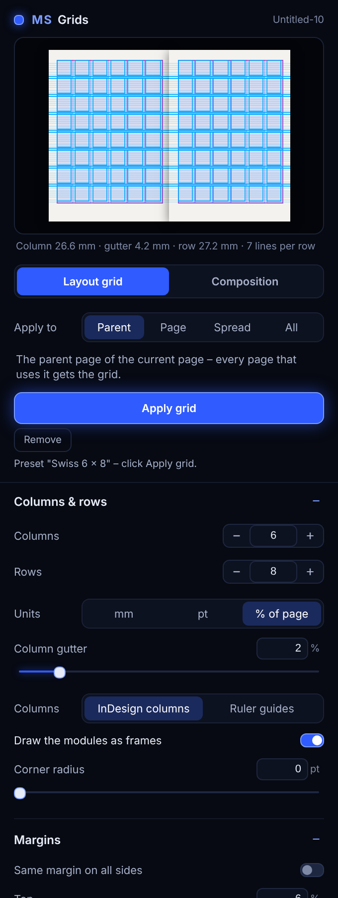

<p align="center">
  
</p>

<p align="center">
  <b>Grids for Photoshop and InDesign: layout grids as real guides, logo construction grids, pattern grids and
  perspective grids – with a live preview of your document.</b><br>
  <sub>Photoshop 2023 (24.2) or newer · InDesign 2023 (18.5) or newer · UXP panels</sub><br>
  <sub>Free Photoshop tools by <b>Morgenstern</b> · <a href="https://github.com/M0rgenst3rn/ms-distress">Morgenstern Distress</a> · <a href="https://github.com/M0rgenst3rn/ms-printer">Morgenstern Printer</a> · <a href="https://github.com/M0rgenst3rn/ms-render">Morgenstern Render</a> · <a href="https://github.com/M0rgenst3rn/ms-phase">Morgenstern Phase</a> · <a href="https://github.com/M0rgenst3rn/ms-glow">Morgenstern Glow</a> · <a href="https://github.com/M0rgenst3rn/ms-gradients">Morgenstern Gradients</a> · <b>Morgenstern Grids</b></sub>
</p>

---

## What is Morgenstern Grids?

One panel for every grid a designer needs in Photoshop:

- **Layout**: columns, rows, gutters, margins and a baseline grid, as Photoshop guides, as a layer, or both
- **Logo**: construction lines around a logo – bounding box, centre lines, diagonals, circles, golden ratio circles, golden spiral and a square grid
- **Pattern**: square, dot, diamond, triangle, isometric and hexagon grids
- **Perspective**: 1-, 2- and 3-point grids. Drag the vanishing points right in the preview

The preview shows your document with the grid on top, before anything changes. Guides are Photoshop's own
guides. Everything else becomes a normal pixel layer with smooth lines that keeps its settings: select it
later, change the values and click **Update grid**.

<p align="center"></p>

### Highlights

- **4 grid kinds, 26 presets**: 12 / 6 column, rule of thirds, modular, Swiss, golden canon, magazine with baseline, social post …
- **Pixels or %**: gutters and margins in pixels or in percent of the size, so a preset fits any format
- **Real guides**: layout grids become Photoshop guides, which snap like any other guide. "Replace existing guides" keeps it tidy
- **Canvas or layer**: fill the whole canvas or just the bounds of the selected layer
- **Logo grids** are built around the selected layer, e.g. your logo or lettering
- **Draggable vanishing points** in the preview for perspective grids – the preview zooms out so points outside the canvas stay visible
- **Fits the canvas**: every grid is calculated for the current canvas. When you change the canvas or image size, grid layers are drawn again for the new size automatically
- **Colour, line width, opacity**; layout layers show lines, column fills or both – fills alone keep a busy layout calm
- **Editable later**: grid layers remember their settings
- **Own presets** and a **self-test** against the real Photoshop result

## MS Grids for InDesign

A second panel for InDesign, made for layout grids only:

- **Columns** become InDesign's own margin and column guides, so text frames, Layout Adjustment and
  *Margins and Columns* all use them. Or place them as ruler guides
- **Rows** are ruler guides, for a modular grid
- **Baseline grid**: set the leading and the rows snap to it. Every row is a whole number of lines with one
  line between rows, so text in every module sits on the same baselines
- **Facing pages**: inside and outside margins are mirrored on left and right pages
- **Apply to** the parent page (default), this page, the spread or all pages. With the parent page, every
  page that uses it gets the same margins and columns
- **10 presets**, mm / pt / % of the page, own presets, **one undo step** for everything, and a self-test

<p align="center"></p>

**How to use it:** open a document and the panel (**Plug-ins › MS Grids**, next to the Window menu), go to a
page that uses the parent page you want, pick a preset or set the values, choose **Apply to** and click
**Apply grid**. **Remove guides** removes the panel's ruler guides; margins and columns stay (change them in
*Layout › Margins and Columns*). Applying again replaces the panel's guides, your own guides stay.

## The grids

**Logo construction**

<p align="center"></p>

**Patterns**

<p align="center"></p>

**Perspective**

<p align="center"></p>

## How to use it

1. Open a document and the panel (**Plugins › MS Grids**)
2. Pick the kind: **Layout**, **Logo**, **Pattern** or **Perspective**
3. Click a preset or set the values. The preview updates as you go
4. For **Logo**, select the logo's layer first. For a grid on part of the image, set **Area** to *Selected layer*
5. Click **Create grid**
6. **Change it later**: select the grid layer ("MS Grid · …"), adjust, click **Update grid**
7. **Remove** deletes the selected grid layer, **Clear guides** removes all guides

**Tips for a calm canvas:** guides can be hidden and shown with **Cmd/Ctrl + ;** at any time. A grid layer
can be hidden like any layer or set to a low opacity. For layout layers, choose *Fills* under *Look & output*
to see only the columns as light bands, without lines.

**When the canvas changes:** grid layers are fitted to the new size automatically (switch *Fit grid layers
when the canvas changes*). Logo grids keep their box. Guides on their own are not changed – click
**Create grid** again with *Replace existing guides* on.

## Installation

There are two plugins. Install the one you need, or both.

### Download (easiest)

On the **[Releases](https://github.com/M0rgenst3rn/ms-grids/releases/latest)** page:

- **MS-Grids-Photoshop.ccx** for Photoshop
- **MS-Grids-InDesign.ccx** for InDesign

Double-click the file. The Creative Cloud app installs it. Then (re)start Photoshop or InDesign.

### macOS with Terminal

1. Download the repository (**Code → Download ZIP**) and unzip it
2. Run this in Terminal inside the unzipped folder:
   ```bash
   bash install-mac.sh            # Photoshop
   bash install-indesign-mac.sh   # InDesign
   ```
3. (Re)start Photoshop → **Plugins › MS Grids**, or InDesign → **Plug-ins › MS Grids**

### Alternative: UXP Developer Tool (macOS & Windows)

1. Install "UXP Developer Tools" from the Creative Cloud app
2. In Photoshop, turn on **Developer Mode** under *Settings › Plugins*
3. In the UXP Developer Tool choose **Add Plugin**, then `grids/manifest.json` (Photoshop) or
   `grids-id/manifest.json` (InDesign) → **Load**

### Self-test

In either panel, open the last section and click **Self-test**. It checks every function against the real
Photoshop or InDesign. In InDesign it creates a test document – close it afterwards without saving.

## Project structure

```
grids/               The Photoshop plugin (loaded into Photoshop as is)
  manifest.json      Plugin description
  index.html         Panel UI
  ms-ui.js/.css      Shared Morgenstern controls and design
  main.js            Photoshop side (guides, grid layers, preview, self-test)
  core.js            Grid geometry and line drawing, plain JavaScript
grids-id/            The InDesign plugin: main.js (InDesign side), core.js (grid maths)
install-mac.sh       Packs the Photoshop plugin (.ccx) and installs it
install-indesign-mac.sh  The same for InDesign
tools/               Checks, preset renderer, icons, browser preview of the panel
docs/images/         Images of this README
```

```bash
node tools/check.js          # checks without Photoshop (geometry, presets, drawing)
node tools/render-test.js    # renders every preset into docs/images
node tools/check-indesign.js # checks the InDesign grid maths
```

## Found a bug? Got an idea?

Get in touch! The easiest way is **[Issues](https://github.com/M0rgenst3rn/ms-grids/issues)** here on GitHub:
click **New issue** and briefly describe what happened. Your Photoshop or InDesign version, operating system and a
screenshot help a lot. All you need is a free GitHub account. Suggestions and feature requests are just as
welcome.

## License

[MIT with the Commons Clause](LICENSE): the plugin is free. You may use it for any work, including paid
client work, and you may read, change and share the code.
You may not sell the plugin or a version of it (changed or not), or charge for a product or service whose
value comes mainly from it.
Everything you create with it (designs, images, prints) is yours, and you may sell it.
The license notice stays in copies.

Adobe, Photoshop and InDesign are trademarks of Adobe Inc. This project is independent and not affiliated with Adobe.

---

<p align="center"><sub>Morgenstern Grids<br>
Made by Linus Leinberger</sub></p>
